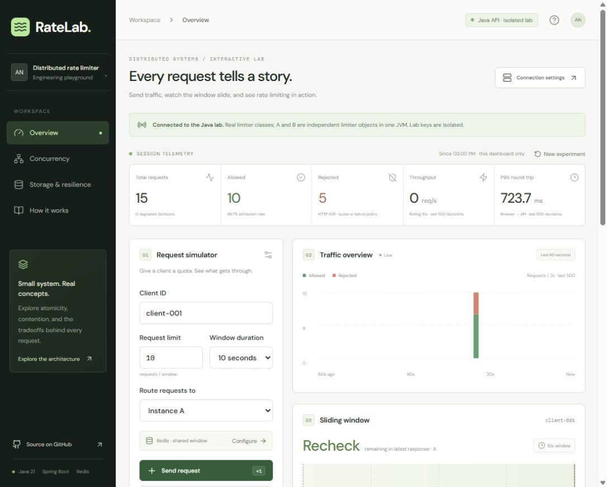

# Verified live deployment — November 6, 2026

| Resource | URL |
| --- | --- |
| Public frontend | https://ratelab-ajaynalla.ajaykumarnalla98.chatgpt.site |
| Java API / combined frontend | https://ratelab-java.onrender.com |
| Health | https://ratelab-java.onrender.com/actuator/health |
| Render health probe | https://ratelab-java.onrender.com/actuator/health/liveness |
| Repository | https://github.com/ajaynalla/distributed-rate-limiter |

The Render web service was observed **Live** on runtime commit `aa9bad2a872bacb914370b7ac132488477ebba63`. The private Valkey 8.1.10 datastore was observed **Available**. Both are Free resources in Virginia. Sites version 2 was published successfully using the existing Site identity. The application stays Java 21 / Spring Boot; Python only verifies deployments.

## Automated verification

[Successful CI run](https://github.com/ajaynalla/distributed-rate-limiter/actions/runs/42283240140) for the deployed runtime commit:

- 53 Java unit, API, and concurrency tests.
- 8 Redis Testcontainers integration tests.
- 12 frontend behavior, API, and component tests.
- 5 Python verifier contract tests.
- SpotBugs, strict TypeScript/Vite build, Compose configuration, combined Docker image build, and real Redis HTTP verification.

All **78 tests** passed. The [public HTTP verification report](live-verification.json) records a separate successful run against the actual cloud origin, including a non-degraded production Redis decision, A/B concurrent quota enforcement, four-client isolation, both injected failure policies, circuit opening, metrics, and the Sites CORS preflight. Its frontend reachability check covers HTML only; browser behavior was verified separately below. Health reported `UP`, production mode `REDIS`, and a closed production Redis circuit.

## Public browser verification

The published Sites dashboard automatically connected with **Java API · isolated lab** and Redis selected. No mock data or browser simulation was used for these results.

| Experiment | Observed result |
| --- | --- |
| Redis, limit 10 / 10s, 15 requests to A | 10 allowed, 5 rejected, 0 degraded |
| Redis, limit 10 / 60s, 1 client × 20 concurrent requests across A/B | 10 allowed, 10 rejected, 0 degraded |
| In-memory, same A/B experiment | 20 allowed, 0 rejected, 0 degraded |
| Injected failure, fail-closed, 15 requests to A | 0 allowed, 15 rejected, 15 degraded; circuit open |
| Injected failure, fail-open, 15 requests to A | 15 allowed, 0 rejected, 15 degraded |
| Return to healthy Redis and repeat 15-request burst | 10 allowed, 5 rejected, 0 degraded |

The UI failure switch injects a throwing delegate under the existing Java resilience decorator. It does not stop the datastore. A/B are independent limiter objects in one JVM; this free deployment has one Java web instance. The original production Redis algorithm retains cross-process support, with independent limiter and real Redis tests in CI.

## Cost and limits

Estimated compute cost is **$0/month within included free usage**. The selected workspace had no payment card on file; no paid service or payment method was added. Included workspace usage observed at deployment was 750 free web hours/month, 5 GB bandwidth/month, and 500 build minutes/month. Usage caps can suspend a no-card workspace. See [Render's current free-plan documentation](https://render.com/docs/free) before changing plans or billing.

The web service sleeps after 15 idle minutes and takes about a minute to wake. Initial Redis setup added seconds to the first real request during validation; warm requests were faster, and all timings remain displayed as measured. Redis has 25 MB, 50 connections, and no persistence. Restarts can reset experiments or quotas. The app demonstrates concurrency and fault tolerance; these free resources do not provide an availability SLA or production scaling guarantees.

See [dashboard usage and local setup](DASHBOARD.md) and [hosting, monitoring, and redeployment](HOSTING.md). Documentation-only commits do not rebuild the runtime image; the tested runtime commit above is the deployed code.
