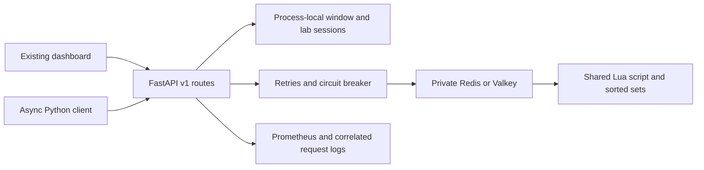

# Python backend migration

The FastAPI service implements the v1 production and lab API, dashboard configuration and counters, Redis and memory windows, and recovery policies. The current frontend source and public assets are preserved. Its hard-coded Java and JVM labels still appear when paired with Python. Java, the existing Render Blueprint, and the Terraform AWS example remain available.

## Run and inspect

1. Run `docker compose -f docker-compose.python.yml up --build` from the repository root. Open http://localhost:8080.
2. `python_backend/app.py` validates the request with Pydantic. Decisions return 200 or 429 with Retry-After on rejection. Invalid requests use HTTP 400 problem responses. Lab state expires after 15 minutes and has session, client, and in-flight limits.
3. `python_backend/limiter.py` owns process-local deques on one event loop. Redis calls await pooled network I/O. Both lab Redis objects execute the existing Lua script against a shared session namespace. The script uses Redis TIME, evicts expired entries, counts and records in one operation, and sets TTLs. redis-py caches the Lua SHA and handles script cache misses.
4. Retry exhaustion invokes the configured failure policy. The circuit allows a single recovery probe after its cooldown. A Redis timeout can occur after the script commits, so a retry can consume quota twice. No exactly-once guarantee is provided.
5. Scrape `/actuator/prometheus` for request counts, latency buckets, and runtime metrics. Use histogram_quantile for p50/p95/p99 and rate on request counters for throughput and HTTP 5xx. Use an external readiness probe for availability. Process metrics depend on platform support. X-Request-Id correlates structured logs when RATELAB_LOG_REQUESTS=true. This is request correlation within one service.
6. `python_backend/client.py` wraps an externally configured httpx.AsyncClient and treats quota rejection as a decision. It leaves timeout and connection pooling policy with the caller.
7. `.github/workflows/python.yml` tests shared quotas against real Redis and runs the deployment verifier against the Python Docker image. Keep the existing Java deploy available until this and browser checks pass. For a cutover, change the existing Render service Dockerfile to docker/Dockerfile.python while preserving its origin and Redis env. Verify /actuator/info identifies Python and run scripts/verify_deployment.py plus an unchanged UI smoke test. Roll back to the prior Java deploy and Dockerfile configuration if checks fail.

## Scope and performance

Redis ZSETs provide timestamp indexing for eviction and the oldest-entry lookup. No relational workload exists to measure database read improvements. Existing Terraform in terraform/main.tf is an optional AWS infrastructure example. No new cloud resources, services, Kubernetes, or autoscaling were added. In-memory state, the circuit, metrics, and lab sessions are process-local. Redis quota can be shared across processes, but the lab requires stable routing. The original Redis key layout is retained for rollback compatibility and inherits the production client ID collision with the :seq suffix. There is no production-scale availability or traffic evidence.

Run `python -m python_backend.benchmark_http http://127.0.0.1:18081 http://127.0.0.1:18082` with both services using the same mode, limit, and 60-second window. The client warms each server before measuring unique-client and hot-key workloads. This is a closed-loop HTTP test, not an isolated limiter benchmark. Python async workers overlap Redis I/O, while Python CPU work serializes on the event loop. Java can execute CPU work concurrently across threads and benefits from JIT warmup. Redis round trips and hot-key serialization affect both.

## Interview questions

1. Why must eviction, counting and insertion happen in one Lua execution?
2. How would you make retries safe if Redis committed a decision before the client timed out?
3. What Redis Cluster slot constraint applies to the window and sequence keys?
4. Why does the memory limiter need separate state or routing with multiple workers?
5. What prevents multiple half-open probes and stale requests from closing a newly opened circuit?
6. How would you migrate away from the legacy sequence key suffix without resetting quotas?
7. What can a p99 from a closed-loop workload hide about overload?
8. How would you distinguish quota rejections from backend failures in alerts?
9. Which lab limits protect resources, and which limits would you enforce before exposing a multi-tenant service?
10. How would you verify the unchanged UI and choose rollback criteria during a runtime cutover?

## Measured local HTTP comparison

One Windows loopback run, Java 21 Spring Boot jar and Python 3.12 Uvicorn, both in memory, limit 10 per 60 seconds, 16 client workers, 300 warmup requests and 2,000 measured requests per case. The Java JVM was configured with ActiveProcessorCount=2. These are end-to-end timings from one run on a shared host.

| Workload | Runtime | RPS | p50 ms | p95 ms | p99 ms | Allowed / rejected |
| --- | --- | ---: | ---: | ---: | ---: | ---: |
| Unique IDs | Java | 255.69 | 29.640 | 222.322 | 374.499 | 2000 / 0 |
| Unique IDs | Python | 251.11 | 30.888 | 222.628 | 407.329 | 2000 / 0 |
| Hot key | Java | 269.07 | 29.760 | 199.059 | 308.821 | 10 / 1990 |
| Hot key | Python | 269.90 | 27.693 | 207.901 | 341.210 | 10 / 1990 |

Neither workload demonstrated the requested 40% latency reduction or 25% throughput improvement. These figures do not estimate Redis performance or daily capacity. Availability and deployment time targets require longer observations and comparable deployment histories.

## Live cutover — November 13, 2026

PR [#3](https://github.com/ajaynalla/distributed-rate-limiter/pull/3) merged into main. Render's existing free service deployed [bc47ed1](https://github.com/ajaynalla/distributed-rate-limiter/commit/bc47ed1fbb990a24f09d4ea8c8309eac719878f5) via the Blueprint. The original API origin and private Redis service were reused. [/actuator/info](https://ratelab-java.onrender.com/actuator/info) returned runtime python.

The public verifier passed liveness, production Redis, A/B shared quota, four-client isolation, both injected failure policies, metrics, CORS, and frontend reachability. The public browser independently returned 10 allowed and 5 rejected with zero degraded decisions in a 15-request Redis burst.

To roll back persistently, revert the Blueprint cutover commit and allow Render to sync the Java Dockerfile. The previous successful Java deploy also remains available in Render's deployment history. Lab sessions are process-local and reset on replacement.

